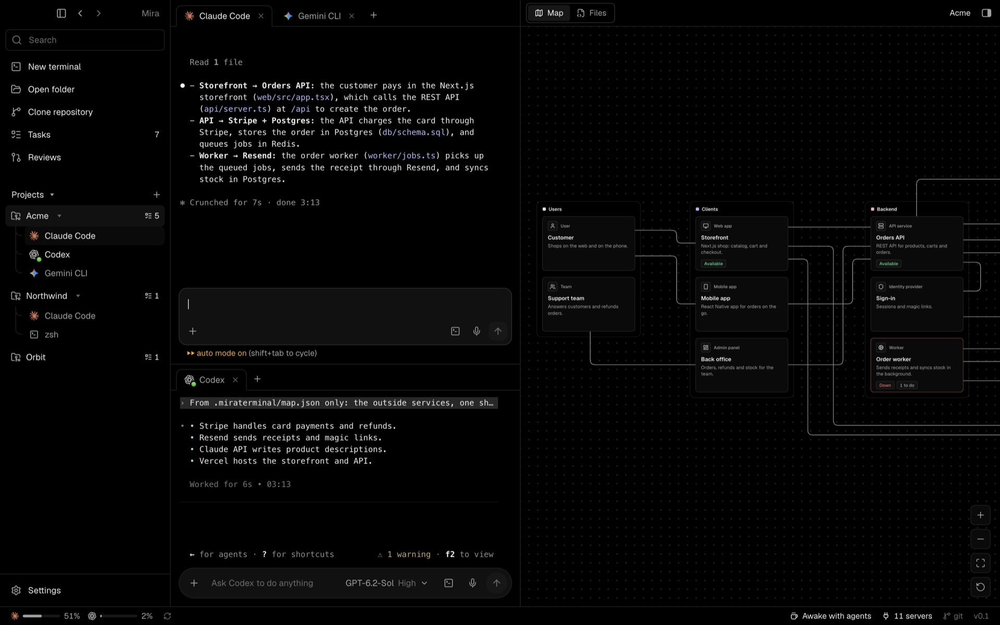
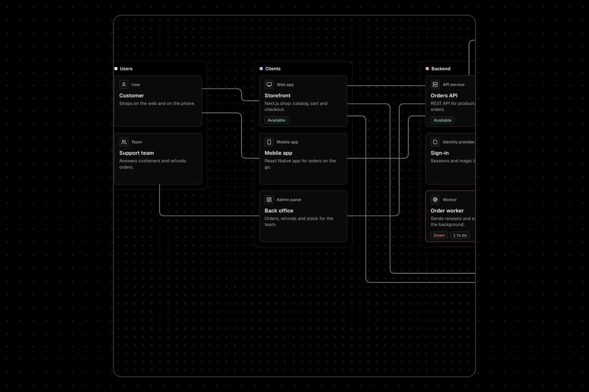
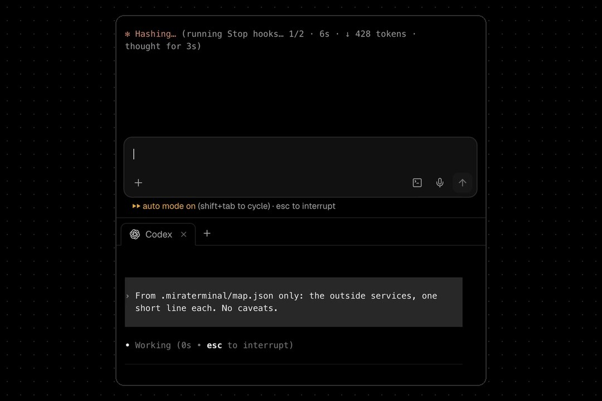
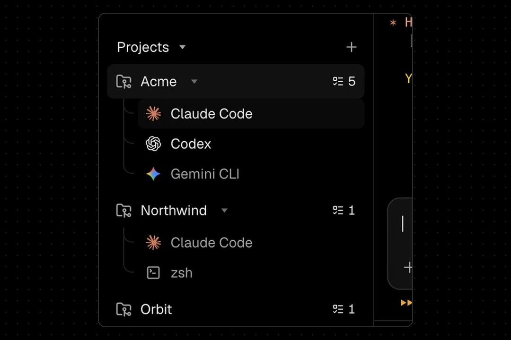
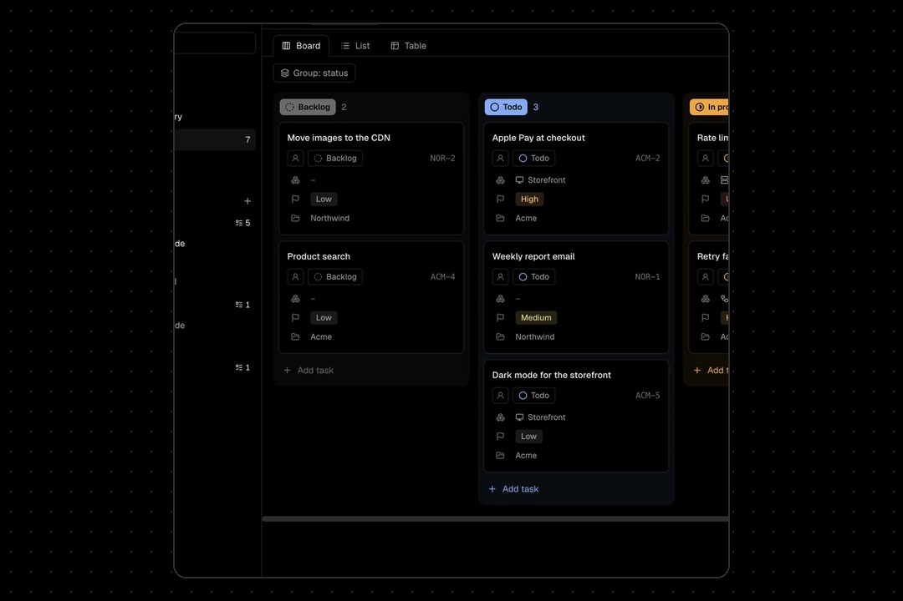
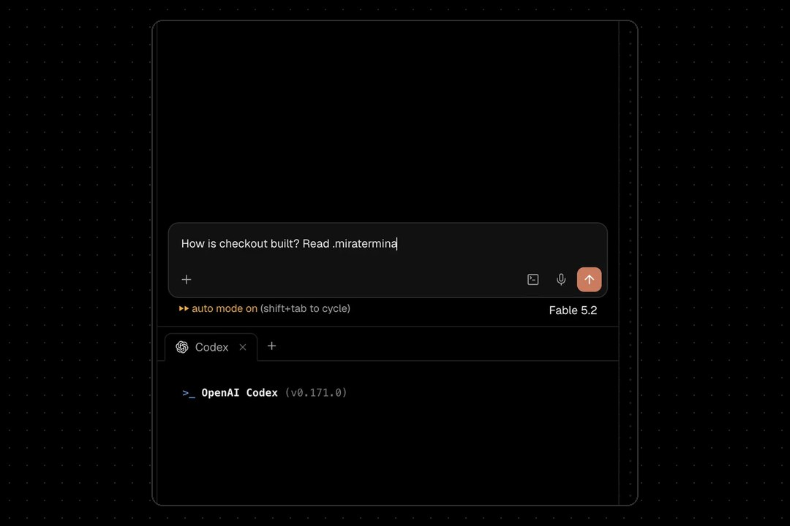
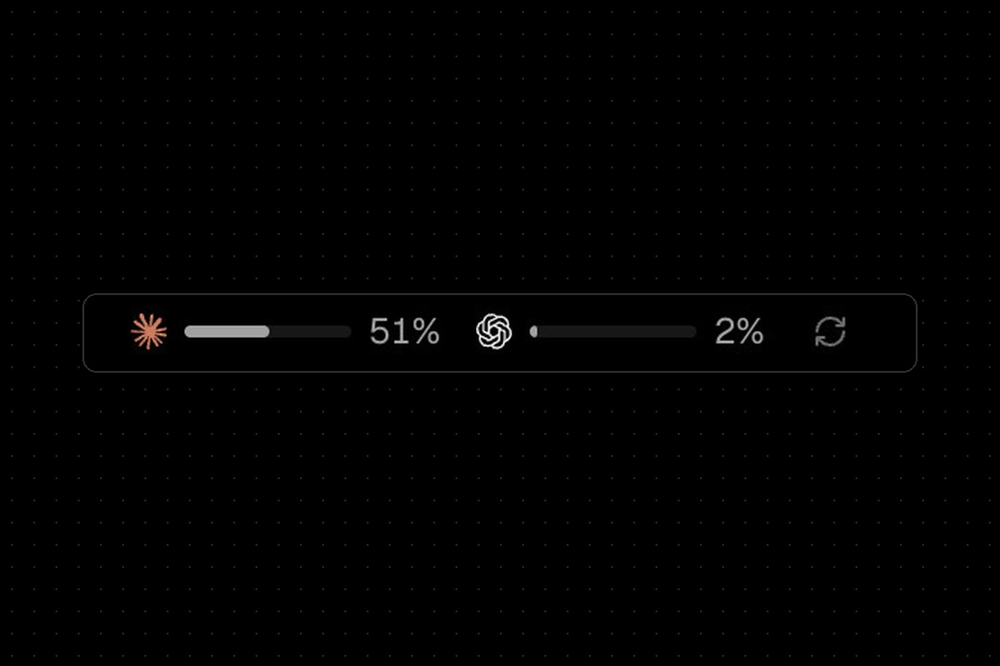

<h1 align="center">
   Mira Terminal
</h1>

<p align="center">
  
  <a href="https://github.com/dump-addict/MIRA-TERMINAL/releases"></a>
  
  
  <a href="https://github.com/dump-addict/MIRA-TERMINAL/actions/workflows/ci.yml"></a>
</p>

<h2 align="center">All in view. Your projects, agents and tasks.</h2>

<p align="center">
  A terminal made for coding agents. Run them side by side, see a live map of every project, and keep every task on one board, on your machine.
</p>

<h3 align="center"><a href="https://github.com/dump-addict/MIRA-TERMINAL/releases/latest"><ins>Download Mira</ins></a> &nbsp;&nbsp; <a href="#features"><ins>See the features →</ins></a></h3>

<p align="center">
  
</p>

## Why Mira

You run Claude Code in one terminal, Codex in another, and lose track of both. Mira puts every agent of every project in one window, draws the map of your code, and keeps the work on one board.

- **No server, no account, no key stored.** Mira is a window on the tools you already have. Your code goes to your agent, as in any terminal, and nowhere else.
- **A map you can trust.** Every link on the map points to a line of code.
- **One agent per branch.** Start from a block of the map, and that part of the project gets its own branch, terminal and agent.

## Features

<table>
<tr>
<td width="50%" valign="middle">

### The project map

Open a project and Mira draws its architecture: the apps, the services, the data and what moves between them. Each link is proven by a line of code, and the map stays up to date as the project moves. Click a block to start an agent on it.

</td>
<td width="50%">
  <picture><source srcset="docs/assets/readme-features/map.webp" type="image/webp"></picture>
</td>
</tr>
<tr>
<td width="50%" valign="middle">

### Every agent, side by side

Claude Code on top, Codex under it, Gemini in the next tab. Tabs, split panes and several windows. Each agent keeps its own message box and tells you when it needs you.

</td>
<td width="50%">
  <picture><source srcset="docs/assets/readme-features/agents.webp" type="image/webp"></picture>
</td>
</tr>
<tr>
<td width="50%" valign="middle">

### All your projects in one place

Every project in the sidebar with its agents under it. A turning ring while an agent works, a green mark when it is done, a yellow one when it needs you. Hover a tab to read its last message.

</td>
<td width="50%">
  <picture><source srcset="docs/assets/readme-features/projects.webp" type="image/webp"></picture>
</td>
</tr>
<tr>
<td width="50%" valign="middle">

### Tasks that get done

A board for all your projects, as a board, a list or a table. Hand a task to an agent and start it from its card. Tasks are saved in your repository, not on a server.

</td>
<td width="50%">
  <picture><source srcset="docs/assets/readme-features/tasks.webp" type="image/webp"></picture>
</td>
</tr>
<tr>
<td width="50%" valign="middle">

### A message box that talks your way

Type, paste a screenshot, drop a file or just speak. Dictation runs on your machine. The agent's own input stays in the terminal, so every command, shortcut and menu still works.

</td>
<td width="50%">
  <picture><source srcset="docs/assets/readme-features/box.webp" type="image/webp"></picture>
</td>
</tr>
<tr>
<td width="50%" valign="middle">

### Your limits in view

Several accounts, each with its usage per day, week and month, so you know which one still has room and a long task never stops halfway.

</td>
<td width="50%">
  
</td>
</tr>
</table>

## Supported agents

Mira finds these on your Mac and gives each one its logo, its message box and its permission modes. Any other agent that runs in a terminal runs in Mira too.

<p>
  <a href="https://docs.anthropic.com/en/docs/claude-code"><kbd> Claude Code</kbd></a> &nbsp;
  <a href="https://github.com/openai/codex"><kbd> Codex</kbd></a> &nbsp;
  <a href="https://github.com/google-gemini/gemini-cli"><kbd> Gemini CLI</kbd></a> &nbsp;
  <a href="https://cursor.com/cli"><kbd> Cursor CLI</kbd></a> &nbsp;
  <a href="https://docs.github.com/en/copilot/how-tos/set-up/install-copilot-cli"><kbd> GitHub Copilot CLI</kbd></a> &nbsp;
  <a href="https://x.ai/cli"><kbd> Grok CLI</kbd></a> &nbsp;
  <kbd>+ any CLI agent</kbd>
</p>

## Getting started

### Download

| System | File |
|---|---|
| macOS, Apple silicon | [`Mira-Terminal-macos-arm64.dmg`](https://github.com/dump-addict/MIRA-TERMINAL/releases/latest/download/Mira-Terminal-macos-arm64.dmg) |
| macOS, Intel | [`Mira-Terminal-macos-x64.dmg`](https://github.com/dump-addict/MIRA-TERMINAL/releases/latest/download/Mira-Terminal-macos-x64.dmg) |
| Windows 10/11, x64 | [`Mira-Terminal-windows-x64.exe`](https://github.com/dump-addict/MIRA-TERMINAL/releases/latest/download/Mira-Terminal-windows-x64.exe) |
| Linux, x64 | [`Mira-Terminal-linux-x64.AppImage`](https://github.com/dump-addict/MIRA-TERMINAL/releases/latest/download/Mira-Terminal-linux-x64.AppImage) |

On a Mac you can also use Homebrew. Mira is not in Homebrew's main catalogue yet, so you add its tap and trust it once; after that, `brew upgrade` keeps Mira up to date:

```bash
brew tap dump-addict/tap
brew trust --tap dump-addict/tap
brew install --cask mira-terminal
```

Every release and its notes are on [GitHub Releases](https://github.com/dump-addict/MIRA-TERMINAL/releases).

**First launch.** Early builds are not signed yet, so your system warns you once:

- **macOS:** right-click Mira Terminal in Applications and choose **Open**, or run `xattr -dr com.apple.quarantine "/Applications/Mira Terminal.app"`.
- **Windows:** when SmartScreen appears, choose **More info**, then **Run anyway**. Agents run in Git Bash, so install [Git for Windows](https://git-scm.com/download/win) first.
- **Linux:** make the AppImage executable with `chmod +x Mira-Terminal-linux-x64.AppImage`, then run it.

You also need at least one coding agent CLI installed and signed in, and Python 3 for the project map (on a Mac, macOS offers to install it with the Command Line Tools).

### Build from source

**Requirements:** Node.js 24 or newer, pnpm 12, Python 3, and a C++ toolchain to compile the native terminal module: the Xcode Command Line Tools on macOS (`xcode-select --install`), Visual Studio Build Tools on Windows, `build-essential` on Linux.

```bash
git clone https://github.com/dump-addict/MIRA-TERMINAL.git mira-terminal
cd mira-terminal
pnpm install   # also rebuilds node-pty for Electron
pnpm dev
```

| Command | What it does |
|---|---|
| `pnpm dev` | Runs the app with hot reload |
| `pnpm build` | Builds the app into `out/` |
| `pnpm start` | Runs the built app |
| `pnpm typecheck` | Type-checks the whole project |
| `pnpm check` | Everything CI runs: typecheck, build, Python and viewer syntax checks |
| `pnpm dist:mac -- --arm64` | Packages the macOS app into `dist/` (`--x64` for Intel) |
| `pnpm dist:win` | Packages the Windows installer into `dist/` |
| `pnpm dist:linux` | Packages the Linux AppImage into `dist/` |

macOS is where Mira is used every day. Windows and Linux builds are new: reports and fixes from people on those systems are very welcome.

## Trusted projects

A repository can ship its own map, and a map can hold checks: shell commands and network calls. Mira never runs them, and never starts an agent on a project by itself, until you choose **Trust project**. Without trust you still get the map, the terminals and your agents.

Trust belongs to a folder and stays after a `git pull`. Turn it off in **Settings › Privacy and security** before pulling code you have not read. The skill follows the same rule: the map server runs checks only when started with `--trust`.

## The map, as a Claude Code skill

The map also works on its own, inside Claude Code, without the app:

```bash
sh install.sh /path/to/your/project          # copy the skill into the project
sh install.sh /path/to/your/project --link   # or link it, to follow this repository
sh install.sh --global                       # or install it for every project
```

Then run `/miraterminal` in Claude Code: it draws the map and opens it in your browser.

## How it is built

| Folder | What lives there |
|---|---|
| `src/main` | Electron main process: windows, terminals (node-pty), projects, agents, map server, dictation |
| `src/preload` | The bridge between the UI and the main process: only these functions are exposed |
| `src/renderer` | The interface: React 19, Tailwind CSS 4, xterm.js, Monaco |
| `skill/miraterminal` | The project map: indexer and server (Python), viewer (plain JavaScript, Three.js) |
| `site` | The landing page |

The look follows one small design system, described in [`DESIGN.md`](DESIGN.md): pure black, hairline borders, colour only for state.

## Contributing

Contributions are welcome. Read [`CONTRIBUTING.md`](.github/CONTRIBUTING.md) before opening a pull request, and open an [issue](https://github.com/dump-addict/MIRA-TERMINAL/issues/new/choose) for bugs and ideas.

Found a security issue? Please report it privately, as described in [`SECURITY.md`](.github/SECURITY.md).

## License

[MIT](LICENSE). Third-party code and assets are listed in [`THIRD_PARTY_NOTICES`](THIRD_PARTY_NOTICES). Agent names and logos belong to their owners and are only used to identify the tools Mira launches.
